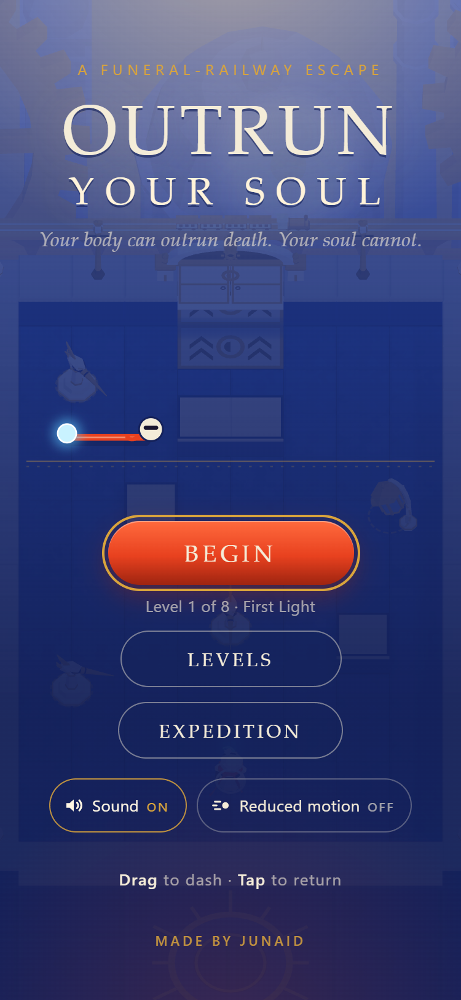
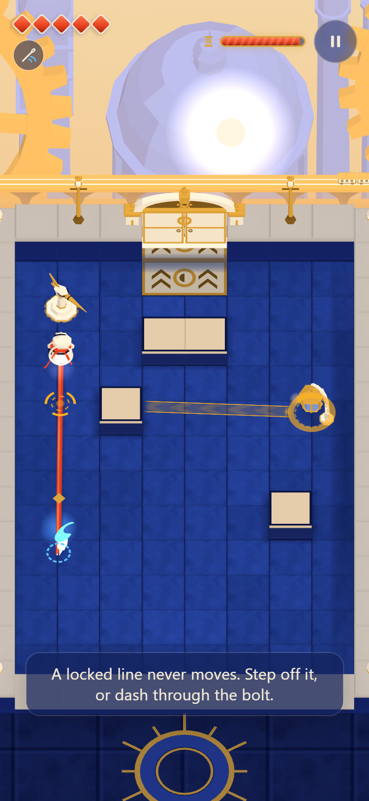

# OUTRUN YOUR SOUL

**Your body can outrun death. Your soul cannot.**

A dead courier steals their body back from a funeral railway. Dash through sunlit courtyards while a slower, vulnerable soul follows the living route you leave behind. Every attack commits a future position for your soul. Every reunion is a choice.

A mobile-portrait, touch-first action roguelite for [Slapjam #2](https://itch.io/jam/slapjam-ai-2), theme **Speed**. Planned art direction: cobalt stone, ivory masks, vermilion thread and distant golden funeral machinery, with Blender-authored models.

## The story

A courier died on the funeral railway, and then stole their body back. Now the body is quick again, sharply, physically alive. The soul is not. It drifts behind on a vermilion thread, walking the exact route the body ran, slower, always arriving later.

To escape, the pair must cross the railway's sunlit cobalt courtyards, past ivory-masked sentries that read the thread as a forecast: Needlers fire at the body, Keepers aim at where the soul *will be*, and Wardens hold their shields toward whoever approaches. Between courtyards wait the Signal Houses, small safe platforms where relics are left for the dead. Beyond them stands the Last Warden, the courier's mirror: fast, armoured, and followed by a slow heart of its own.

Every dash is a promise the soul must keep. Every reunion is a choice. The gate only opens for both of you.

## Identity

There is no logo or cover art yet. The identity that exists is the in-game one:

- **Wordmark:** "OUTRUN YOUR SOUL" set in a system serif, under the kicker "A funeral-railway escape".
- **Tagline:** *Your body can outrun death. Your soul cannot.*
- **Palette** ([src/content/palette.json](src/content/palette.json)): cobalt stone, ivory masks, vermilion silk for the thread, gold funeral machinery, a pale cyan soul. Amber is reserved for attack warnings and violet for environmental lanes, so gameplay signals never blend into the architecture.

  
  

Captured from the built game in desktop Edge with phone-size emulation (375x812), not on a phone.

## Status

**Playable expedition, verified on desktop browsers and emulated phone viewports only. Not yet tested on a real phone, not published to itch.io, not submitted to the jam.**

What exists (30 October 2026):
- Deterministic 2D combat simulation (fixed 120 Hz step, event-time-ordered sweeps): finite-speed dash, slower route-following soul, vulnerable RETURN, genuine-contact reunion, shared health with attack-ID dedup, needler / keeper (forecast aim on the soul's route) / warden, persistent lanes, four behavioural relics plus Long Silk / Short Stitch parameters, and the Last Warden boss.
- Run layer: six relics (14 legal pairs), two starters, a seeded branching expedition (opening, two branches, two stations with drafts, final approach, boss, ending), room-entry checkpoints ("Continue restarts this room."), progress atlas.
- Six room templates with two authored variants each (validated, cleared by novice- and expert-timed planning bots) plus the boss arena.
- Three.js orthographic presentation with 18 original Blender-authored GLB models (made through the pinned Blender MCP bridge, Khronos-validated, provenance in `art/provenance.csv`), touch gestures, procedural WebAudio, accessible DOM UI.
- Evidence: automated test suite, model validation, itch-style nested-iframe package check, and Edge/Chrome end-to-end runs including a full expedition, reload-to-Continue and defeat-to-Retry. See [docs/EVIDENCE.md](docs/EVIDENCE.md).

Not yet done: real-phone input/performance testing (the roadmap gate), human playtesting of difficulty and build divergence, itch upload and jam submission.

Official deadline: **31 October 2026, 15:00 UTC / 20:30 IST**. Internal submission target: **12:00 UTC / 17:30 IST** that day.

## Start here

Give your implementation agent this assignment:

> Read AGENTS.md and the linked documents. Follow ROADMAP.md from the current repository state. First prove one polished touch encounter and the Blender-to-browser asset pipeline on a real phone. Preserve the combat rules, record test evidence, and expand only after the gates pass. Do not claim a feature or submission exists before verifying it.

- [Agent instructions](AGENTS.md)
- [Roadmap and acceptance gates](docs/ROADMAP.md)
- [Game vision and play loop](docs/GAME_DESIGN.md)
- [Authoritative combat rules](docs/COMBAT_SPEC.md)
- [Rooms, enemies, relics and replay depth](docs/CONTENT.md)
- [Technical architecture](docs/ARCHITECTURE.md)
- [Blender MCP art pipeline](docs/ART_PIPELINE.md)
- [Asset manifest and priorities](docs/ASSET_MANIFEST.md)
- [Testing and evidence plan](docs/TEST_PLAN.md)
- [itch.io publishing and Slapjam submission](docs/SUBMISSION.md)
- [Release checklist](docs/RELEASE_CHECKLIST.md)
- [Category goals and delivery status](docs/QUALITY_AND_STATUS.md)

## Scope that protects the idea

The jam target is three enemy roles, six authored room templates used as a branching pool, one warden encounter, six relics with two equipped slots, two starting sidegrades, and room-entry checkpoints. Repeat play should change routes and target priorities, not simply increase health or grind requirements. A 10–15-minute expedition and play across later sessions are targets to test, not measured promises.

The foundation is a deterministic 2D combat simulation with an orthographic Three.js presentation. Blender creates visual assets; it does not determine collision or damage. Renderer feasibility is tested early, with a prerendered-sprite fallback before mass asset production. No runtime AI API, account system or paid backend is needed.

## Development commands

Requires Node.js (developed with v26.8.1) and npm. Dependencies are pinned to exact versions in `package-lock.json` (TypeScript 7.0.2, Vite 8.3.5, Vitest 5.0.5, Three.js 0.187.0; release tooling uses fflate 0.8.3, the Khronos glTF Validator 2.0.0-dev.3.10 and playwright-core 1.64.1).

| Command | What it does |
|---|---|
| `npm ci` | Install the exact locked dependencies. |
| `npm run dev` | Vite dev server (also on the LAN via `--host`, for phone testing on the same network). |
| `npm test` | Vitest unit tests (simulation, tooling). `npm run test:watch` re-runs on change. |
| `npm run typecheck` | `tsc --noEmit` over `src/`, `tests/` and the Vite config. |
| `npm run build` | Typecheck, then production build into `dist/` with a relative base (`./`) for itch.io's nested iframe URL. |
| `npm run preview` | Serve the built `dist/` locally. |
| `npm run package` | Build, check `dist/` against itch.io's HTML5 ZIP rules and project policy, then write a deterministic `release/outrun-your-soul-<version>-<shortsha>.zip` (`-dirty` suffix if the working tree has uncommitted changes) plus a `.json` manifest; prints the ZIP name, byte size and SHA-256. |
| `npm run check:nested` | Serve `dist/` (or `-- --zip release/<name>.zip`, or `-- --zip latest`) under an itch-like nested, case-sensitive path inside a cross-origin iframe and crawl every reference; fails on any non-200. `-- --serve` keeps it running so the printed embed URL can be opened in a browser. |
| `npm run check:models` | Validate `public/assets/models/*.glb` (shipping) and `art/exports/*.glb` (fixtures, never shipped) with the Khronos glTF Validator plus the asset-contract and budget checks; writes `art/reports/models-validation.json`. |
| `npm run verify` | Typecheck, tests, build, package, model validation and the nested crawl of the exact new ZIP, with a summary. |
| `npm run e2e` | Build, serve under the nested itch-like path, and drive an **already installed** Edge or Chrome (pinned playwright-core; it never downloads a browser) at 375x812, DPR 2, touch. Covers the production load (no debug hook, WebGL2, live scene renders the packaged GLBs), the real UI path (Begin → starter → room → Onward → route choice → next room), a real touch drag dash and tap RETURN, pause on hidden/blur, reload → Continue restarting the same room, a deliberate defeat → Retry room, and a full expedition to the ending. Writes `art/previews/e2e-*.png` and `art/reports/e2e-report-<browser>.json`. Options: `-- --zip release/<name>.zip` (test the exact upload), `-- --no-build`, `-- --browser chrome`, `-- --seed N`, `-- --headed`. Exit 2 means no system browser was found. Its numbers come from a desktop browser and are not phone evidence. |

These are automated checks only. They do not replace real-phone testing or testing the uploaded itch.io page; record those in [docs/EVIDENCE.md](docs/EVIDENCE.md).

## Rights and credits

**Music:** "Cathedral in the forest (ambient loop)" by [congusbongus](https://opengameart.org/users/congusbongus), from [OpenGameArt](https://opengameart.org/content/cathedral-in-the-forest-ambient-loop), dedicated to the public domain under CC0 1.0. Credit is not required; it is given with thanks. Record: [art/provenance-audio.csv](art/provenance-audio.csv). All sound effects are synthesized in the browser; all 3D models are original (see [art/provenance.csv](art/provenance.csv)).

No open-source license has been selected. Public visibility alone does not grant a blanket reuse license. Keep third-party licenses and attribution with their assets. Credit AI-assisted work accurately according to the platform and jam rules. Do not commit private prize-contact answers, credentials or correspondence.
