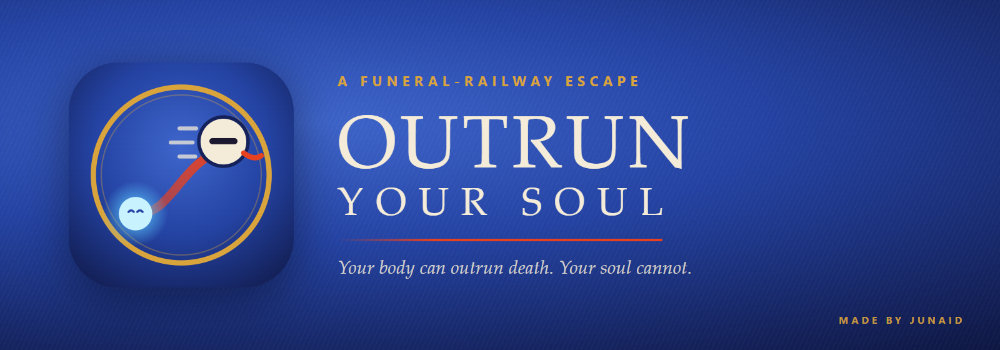
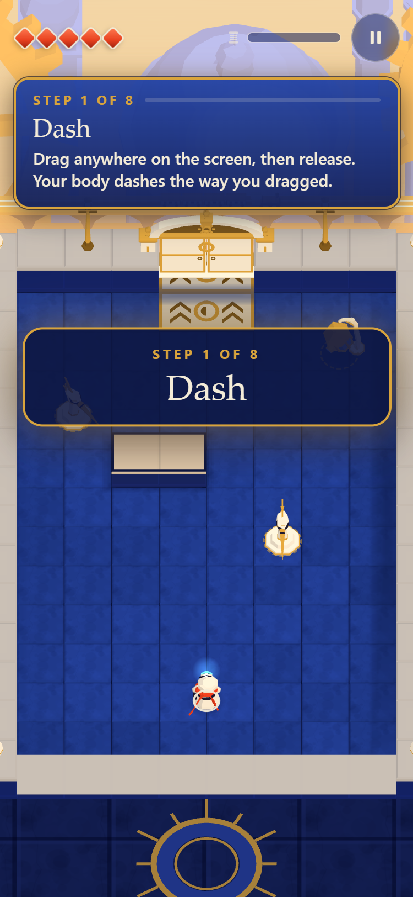
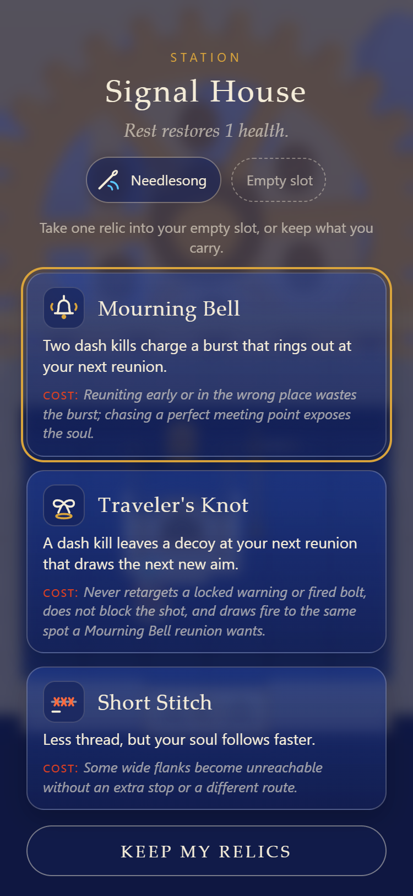
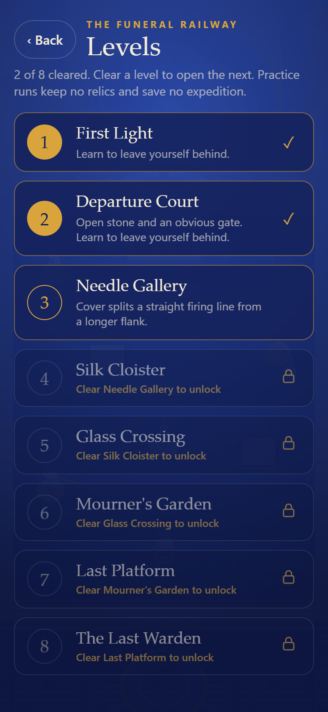
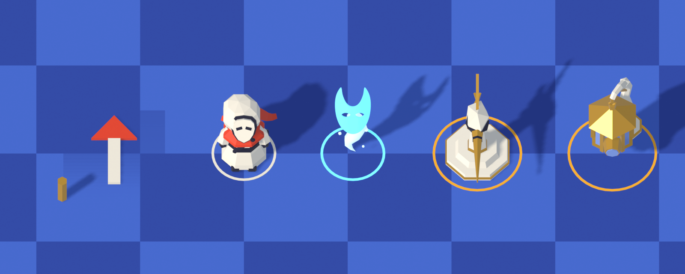
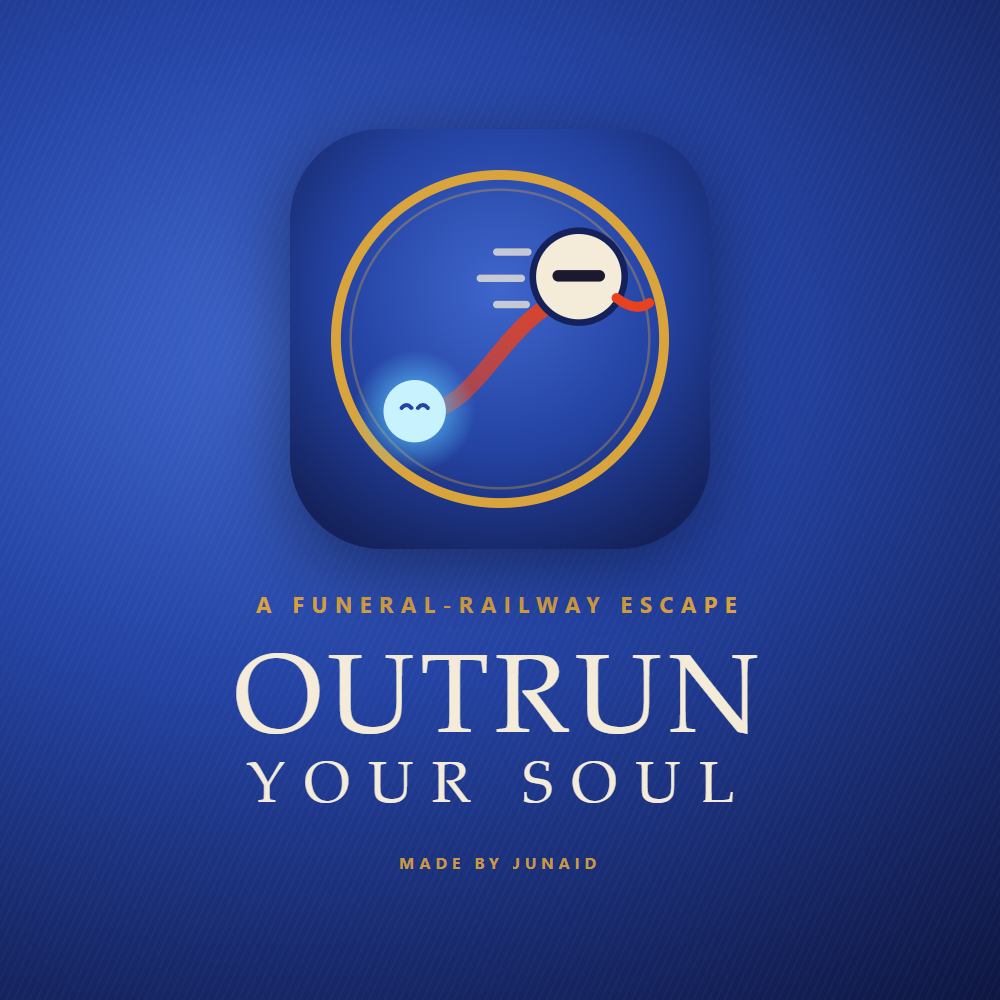
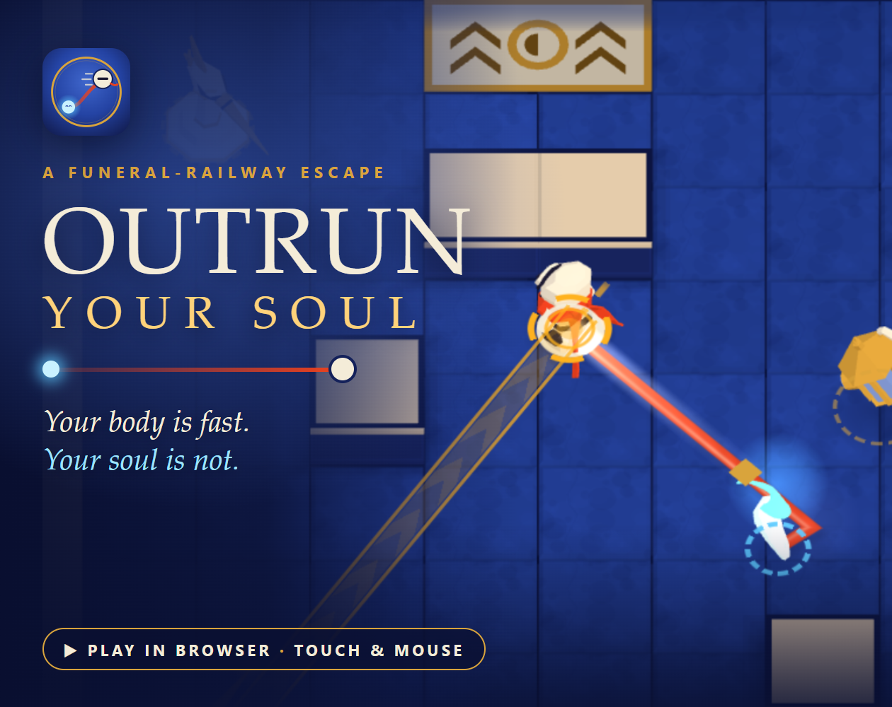

<p align="center">
  
</p>

<p align="center">
  <a href="https://outrun-your-soul.vercel.app"><b>▶ Play in your browser</b></a>
  &nbsp;·&nbsp; portrait, touch-first &nbsp;·&nbsp; works with a mouse too
  &nbsp;·&nbsp; made for <a href="https://itch.io/jam/slapjam-ai-2">Slapjam #2</a> (theme: <b>Speed</b>)
</p>

---

A dead courier steals their body back from a funeral railway. The body is fast. The soul is not: it follows the exact route you ran, slower, on a vermilion thread. Every dash is a promise your soul has to keep, and enemies aim at where your soul **will be**.

<p align="center">
  
  
  
  
</p>
<p align="center"><sub>Captured from the built game in desktop Edge at phone size (375×812). Not phone photos.</sub></p>

<p align="center">🎬 <a href="https://youtube.com/shorts/G66UWlb5-CQ"><b>Watch the 23-second demo video</b></a> (title → story → Departure Court → the gate opens)</p>

## How to play

| Gesture | What happens |
|---|---|
| **Drag anywhere, release** | Your body **dashes** that way. A dash cuts through sentries and their bolts, and only the dashing body is protected. |
| **Wait** | Your **soul** walks the thread you left, slowly, and rejoins you when it arrives. |
| **Tap** | **Return**: your body runs back along the thread to meet the soul. You are vulnerable while you do. |
| **Dash into your soul** | Touching it rejoins you **at once**. The gold ring in the preview shows where. |

The red thread is a forecast, never a weapon. Only your body and your soul can be hit, and they share one health bar. Amber lines are shots about to fire; once one locks, it never moves. The exit gate opens only for both of you.

## The story

You died on the funeral railway, and then you took your body back. Each level opens with one line of the story, and it unfolds in order from the first courtyard to the last train:

1. **First Light** — the onboarding level: eight short lessons, live sentries, and no way to lose.
2. **Departure Court** — learn to leave yourself behind.
3. **Needle Gallery** — cover splits a straight firing line from a longer flank.
4. **Silk Cloister** — close as the crow flies, far along the thread.
5. **Glass Crossing** — funeral light sweeps the court; your soul crosses later than you do.
6. **Mourner's Garden** — sentries ring a guarded centre; choose where you meet.
7. **Last Platform** — every role at once around one narrow opening.
8. **The Last Warden** — it is fast too. Its heart is not.

Levels unlock strictly in order. **Play** on the title screen starts the next one you have not cleared; **Levels** replays any you have opened.

## Two ways to play

- **Levels** — the eight levels above, in order, with the story between them.
- **Expedition** — a roguelite run through the same railway: a seeded, branching route of rooms, two Signal House stations where you draft **relics** (six of them, two slots, fourteen legal pairs), two starting builds, and the Last Warden at the end. Progress is saved at each room's entrance: *Continue restarts this room.*

## How it is built

- **A deterministic rules engine** (`src/sim`) runs at a fixed 120 Hz on a flat 2D plane and resolves every collision in true event-time order, so array order never decides who gets hit. The preview line you aim with runs the same code as the real dash.
- **Three.js presentation** (`src/render`): a fixed orthographic camera over the 2D game, toon lighting, a living ribbon drawn from the real route, and short effects driven only by game events.
- **Touch-first input** (`src/input`): one finger owns a gesture; dead-zone cancel, long-press ignore, and pause on any interruption.
- **Synthesized sound** (`src/audio`): every effect is generated in the browser. The body plucks a note, the soul answers an octave lower a moment later, and reunions resolve into a chord.
- **18 original 3D models**, built in Blender 5.2 through a pinned, hash-verified [Blender MCP](https://github.com/ahujasid/blender-mcp) bridge, validated with the Khronos glTF Validator, about 1.2 MB in total.

<p align="center">
  
</p>
<p align="center"><sub>The cast, rendered in Blender at true relative scale on their collision rings.</sub></p>

## Brand

| Asset | File |
|---|---|
| Mark (icon) | [`art/brand/mark.svg`](art/brand/mark.svg) · small-size variant [`mark-small.svg`](art/brand/mark-small.svg) |
| Banner | [`art/brand/banner.png`](art/brand/banner.png) |
| Stacked logo | [`art/brand/logo-stacked.png`](art/brand/logo-stacked.png) |
| itch.io cover (630×500) | [`art/brand/itch-cover.png`](art/brand/itch-cover.png) |
| Social card (1200×630) | [`public/og.jpg`](public/og.jpg) |
| Demo video (23 s, 720×1558, H.264 + AAC) | [`art/video/outrun-your-soul-demo.mp4`](art/video/outrun-your-soul-demo.mp4), recorded by `node scripts/demo-video.mjs` |
| Favicons and app icons | `public/favicon.svg`, `favicon-16/32.png`, `apple-touch-icon.png`, `icon-192/512.png`, `icon-maskable-512.png`, `site.webmanifest` |

The mark shows the game in one picture: the ivory masked body racing ahead, the pale soul trailing on the vermilion thread, inside the gold ring of the railway. The palette is fixed in [`src/content/palette.json`](src/content/palette.json): cobalt stone, ivory, vermilion for the thread, gold for the machinery, cyan for the soul; amber is reserved for attack warnings and violet for hazard lanes. Every raster asset is regenerated by `node scripts/brand.mjs`, which renders the SVG sources with the locally installed Edge.

<p align="center">
  
  &nbsp;
  
</p>

## Development

Requires Node.js (developed with v26.8.1). Dependencies are pinned exactly in `package-lock.json`: TypeScript 7.0.2, Vite 8.3.5, Vitest 5.0.5, Three.js 0.187.0; release tooling uses fflate 0.8.3, the Khronos glTF Validator 2.0.0-dev.3.10 and playwright-core 1.64.1.

```bash
npm ci
```

```bash
npm run dev
```

| Command | What it does |
|---|---|
| `npm run dev` | Vite dev server (also on the LAN via `--host`, for testing on a phone on the same network). |
| `npm test` | Unit and simulation tests. |
| `npm run typecheck` | `tsc --noEmit` over sources, tests and config. |
| `npm run build` | Production build into `dist/` with a relative base for itch.io's nested iframe. |
| `npm run package` | Build, check against itch.io's HTML5 ZIP rules, and write a deterministic `release/outrun-your-soul-<version>-<sha>.zip` with its SHA-256. |
| `npm run check:nested` | Serve the build under an itch-like nested path inside a cross-origin iframe and confirm every file loads. |
| `npm run check:models` | Khronos glTF validation plus the project's asset-contract and budget checks. |
| `npm run verify` | Typecheck, tests, build, package, model checks and the nested crawl in one run. |
| `npm run e2e` | Drive an already-installed Edge or Chrome at 375×812 with touch: the tutorial lessons, levels in order, a real drag-dash and tap-return, pause on interruption, reload → Continue, defeat → Retry, and a full expedition to the ending. Never downloads a browser. |

Debug URL options: `?debug` exposes a test hook, `?seed=N` fixes the expedition seed, `?tutorial=0|1` forces the tutorial off or on.

## Status

**Playable from start to finish in desktop browsers and at emulated phone sizes. Not yet tested on a real phone or by players; not yet uploaded to itch.io or submitted to the jam.** Automated evidence (unit and simulation tests, model validation, package checks, end-to-end browser runs) is logged in [docs/EVIDENCE.md](docs/EVIDENCE.md); real-device rows remain open. Difficulty is tuned with planning bots that aim perfectly, so human difficulty is unverified.

Design and engineering docs: [game design](docs/GAME_DESIGN.md) · [combat rules](docs/COMBAT_SPEC.md) · [content](docs/CONTENT.md) · [architecture](docs/ARCHITECTURE.md) · [art pipeline](docs/ART_PIPELINE.md) · [asset contract](docs/ASSET_CONTRACT.md) · [roadmap](docs/ROADMAP.md) · [test plan](docs/TEST_PLAN.md) · [submission](docs/SUBMISSION.md) · [agent instructions](AGENTS.md).

## Credits

**Made by Junaid.**

- **Music:** "Cathedral in the forest (ambient loop)" by [congusbongus](https://opengameart.org/users/congusbongus), from [OpenGameArt](https://opengameart.org/content/cathedral-in-the-forest-ambient-loop), dedicated to the public domain under CC0 1.0. Credit is not required; it is given with thanks. Record: [art/provenance-audio.csv](art/provenance-audio.csv).
- **3D models, brand art and sound effects:** original to this project. Models were authored as Blender Python scripts executed through the Blender MCP bridge; sound effects are synthesized in the browser. Provenance: [art/provenance.csv](art/provenance.csv).
- **AI assistance:** code, models, brand art and documentation were produced with Claude Code agents, directed by the author.

No open-source license has been selected; public visibility does not grant a reuse license. Third-party licenses stay with their assets.
